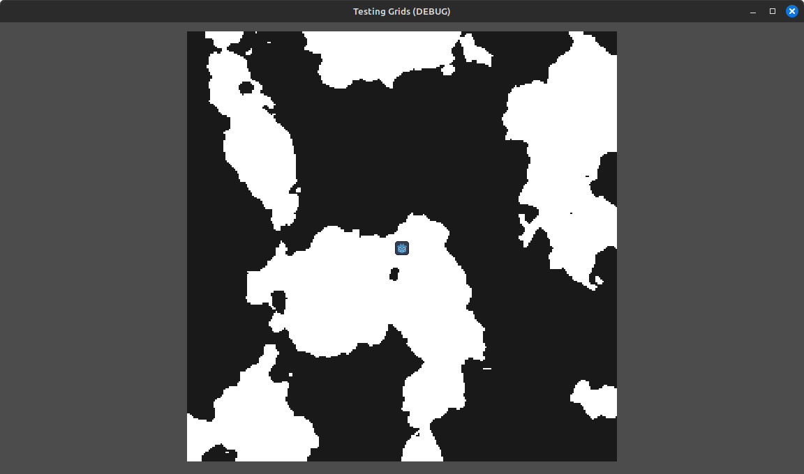

Customer Support and Success is one of the most important pillars of a successful B2B business. In order to provide a great customer experience, the business needs to stay closely connected to their customers.

Just a few years ago, [Funnel](https://www.funnel.io) faced a significant disconnect between our commercial teams and our customers' actions within our app. This resulted in missed opportunities and preventable churn. Through strategic improvements in our data infrastructure and architectural design, we enabled our teams to change from being reactive to customer communication to proactively assist and reach out to our customers when they need help. This had immediate impact to our bottom line: we observed an increase of our Annual Recurring Revenue (ARR) by over 2 million USD in 2 years. In this article, I will describe the obstacles, the decisions and the inner workings of the solution.

## Problems
### Difficult and time consuming to understand customer behavior

Hubspot was and still is our central commercial nervous system. All revenue teams work in some way or another with the platform. Hubspot was however fully disconnected from our app when I started. Our commercial teams struggled with lack of insight into what our customers and leads were doing in-app. They had to resort to check every customer manually in our reporting tool. Since this took a good amount of time, most had to resort to only react on important events like renewals and customer communication, instead of reaching out to help and support.

### Inaccurate data
On top of that, in order to see which company paid for which subscription, our sales team was forced to copy-paste Ids on deals and companies. Only then was our Finance team able to assign the right revenue to the right subscriptions. As you may imagine, this did not only cost thousands of hours of admin work, but also produced inaccurate data, as wrong data was copied or entirely forgotten on a regular basis.

### Architecture Design:

Fortunately we already had a pipeline set up that imported data into BigQuery and Looker for reporting.

In theory, we could have pushed our app data right onto a Hubspot company. But that would have meant ignoring the severe fundamental architectural issue:

- A customer of Funnel can pay for multiple subscriptions.

When looking carefully at the underlying data schemas of Funnel and Hubspot, we find that

- Funnel has subscription and user entities.
- Hubspot has contacts, deals, and companies. It has no notion of a subscription entity.

Therefore if we would simply copy data from our in-app subscription data to our Hubspot company, we would face a dilemma: we could continuously overwrite the same property of one company with the data of two different subscriptions, in case a company “owns” 1+ subscriptions.

IMAGE

If you are familiar with data modelling, you already know that this is a classical one-to-many data model (1:N) that comes with all the consequences.

IMAGE

Even though only 10% of our customers had more than one subscription, this would mean our reps could only trust 90% of the data. This is not a good enough trade-off for us. We need to be sure that the data we see in Hubspot is correct. Any doubt of the correctness defeats the purpose and will lead people to make manual changes again.

Fortunately Hubspot released a new beta at that time: [custom objects](https://www.hubspot.com/products/custom-objects). We were eager to jump on that new functionality, because it gave us the possibility to create a 1:1 relationship between our subscription in Funnel and our new custom object in Hubspot.

With this we could fully trust that each record is unique and correct. It was a downstream mirror of whatever happens in the app. Furthermore a company could be associated as a 1:N relationship between records of the new custom object, which models reality quite well. That means that a company can have 0:N associated “Tenant” subscriptions (subscriptions that they are paying for) and a subscription could only have 0:1 Tenants(only one company can pay for a subscription).

This prevents overwriting the same property on the company object, because all subscription data is now hosted on that new object.

IMAGE

After some experimentation we created a new custom object in Hubspot via [API](https://developers.hubspot.com/docs/api/crm/crm-custom-objects?uuid=e1a07f12-8bc4-44bc-81b2-b739f602c4f6) (nowadays you can also do it via the GUI), which we creatively called Subscription Object (SO).

## Process Design
Now we just needed a reverseETL tool that allowed us to pipe that data from our warehouse to Hubspot. After some experimentation we decided for Hightouch. This is mainly because of Hightouch’s better association capability between objects at the time, but also because we only had one destination and therefore we could use their free plan.

IMAGEThe project has had big impact in our customer retainment and growth metrics. Furthermore and maybe more importantly, this has broken down a lot of architectural obstacles that allows for so many more functionalities. Creating a mirror of our app data has enabled us move faster and with more confidence.

It also showed me that it is important to look further than the next quarter and the next project. It makes sense to not just incrementally improve, but to dare to take that step-change.

What became clear as well is that a technical change only becomes a real success, when enablement and onboarding is taken care of. Habits are hard to change. I feel like this has been said a thousand times before, but I only ever really felt it once I started working in Revenue Operations.

on table and upsert (update if existing; create if new) each record into our new custom object. This sync runs each day and continuously updates our subscriptions with the latest data from the app.

2. Users → Hubspot Contacts

One problem remained: the subscription records were not associated to any company, because we simply do not have company information in the app.

What we have are user email addresses and “Subscription Owner” information. A “Subscription Owner” in the app can be understood as an Admin and we made the deliberate assumption (it is extremely important to be aware of assumptions, as they can completely break a system if unknown. I recommend articulating assumptions explicitly) that those users are from the company that pays for the subscription. Obviously this is not always the case. There are scenarios where a “Subscription Owner” does not belong to the company that pays for the subscription. We deliberately accepted that risk since we deemed it unlikely enough to tolerate in lieu of better identification mechanisms. I will come back to this later, as this is an important moment in the project and it deserves some more discussion.

Back to the topic: Email addresses contain domains names, like tim@tester.com. The domain tester.com of that email address is the basis of a company in Hubspot. When an email with that domain enters Hubspot, Hubspot checks if a company with that domain exists already. If so, the contact gets automatically associated to that company. Otherwise a new company is created and subsequently associated.

We used that email domain mechanism to upsert users into Hubspot, mark those users who are subscription owners and then associate their company to our subscriptions. That association was done via custom code in a workflow that was triggered by new contacts/subscription owner information.

IMAGE

With this association in place, we can copy the assigned CSP from the company to the SO. And with the daily updates coming in, we knew who to notify when something needed attention.

With the hard data engineering work done, setting up the rest of the process was simple:

- with the daily updates we received our customers usage data.
- in case some usage metrics crossed predetermined thresholds, we triggered a Hubspot workflow to send a task/notification to our CS reps.

To identify the impact of these changes we started tracking the deals closed after receiving a notification and had our reps confirm the reason for the new closed deal. We found out that due to these changes we were able to create more than 2M USD ARR over 2 years with just this one new feature.

## Trade-Offs

    “There are no right and wrong answers in architecture - only trade-offs” source.
    
    Neal Ford, Fundamentals of Software Engineering

Not all is rosy with our solution. It has improved our previous system, but it is not perfect. However, we deliberately choose to take these trade-offs in order to improve our system. Here are some of our tradeoffs:

**We accepted a certain kind of uncertainty with company-subscription associations**

As we have discussed before, by associating companies and subscriptions on the basis of the Subscription Owner, we accepted the risk of incorrect data. We needed to map those two entities together, but instead of relying on validated data from users, we relied on approximate data in the product. We deemed the likelihood of wrong data from the app smaller than that of data input from our sales representatives.

This turned out to be true, however in complicated cases of big agency customers or other complicated setups, the data might be incorrect and we need to adjust manually. This is not ideal, but we traded a bad to a significantly better situation that required only a fraction of time investment and more accurate data.

We also assumed that at some point in the future, the product will have an improved understanding of the owner of a subscription. We are moving closer and closer to that vision every month. With our new freemium offering and the possibility of self-serving, we have achieved this goal, but the large and complicated subscriptions still remain and need to be assessed once in a while. I believe that we will be able to also migrate the larger subscriptions to the new system, which then completely nullifies this trade-off.

**Multiple subscription owners from different companies**

It is possible that a subscription can have several subscription owners from different companies. This obviously makes it fairly uncertain which company is the Tenant. Generally we take the first subscription owner that was ever submitted, but it does not 100% solve the problem as ownership can change. We accepted that this will remain a problem, until our Finance tools are directly integrated with our app and we can uniquely identify the company directly. This solves issue 1. and 2. Also this is being worked on and surely solved in the close future.

**Out-of-date data**
Since our BI team is ingesting data on a daily basis, any usage notification could not be correct anymore. We saw that sometimes our customers have just for a brief moment crossed one of our internal notifications thresholds, but since we had no real-time updates, it could be that we send out information that is already incorrect when our reps checked in. This leads to trust issues.

As an answer to that we made sure not to use time-sensitive metrics for notifications. For example we would not send out notifications when a user has crossed usage limits for the first time, but only when it was above limit for 7 days. That removes the scenario that it was just a blip. It still remained possible however that data in HS was incorrect for at least 24h. That was a big reason to work on our real-time data pipeline from our app into our commercial tools, which we have solved as of end of 2023.

As of now this has been solved, because we have successfully implemented our real-time data pipeline. This allows us to get a health check of our customers in seconds. A new customer struggling with a new destination we can now check-in on them immediately and alleviate the frustration, leading to improved customer experience.

## Closing thoughts:
The project has had big impact in our customer retainment and growth metrics. Furthermore and maybe more importantly, this has broken down a lot of architectural obstacles that allows for so many more functionalities. Creating a mirror of our app data has enabled us move faster and with more confidence.

It also showed me that it is important to look further than the next quarter and the next project. It makes sense to not just incrementally improve, but to dare to take that step-change.

What became clear as well is that a technical change only becomes a real success, when enablement and onboarding is taken care of. Habits are hard to change. I feel like this has been said a thousand times before, but I only ever really felt it once I started working in Revenue Operations.

